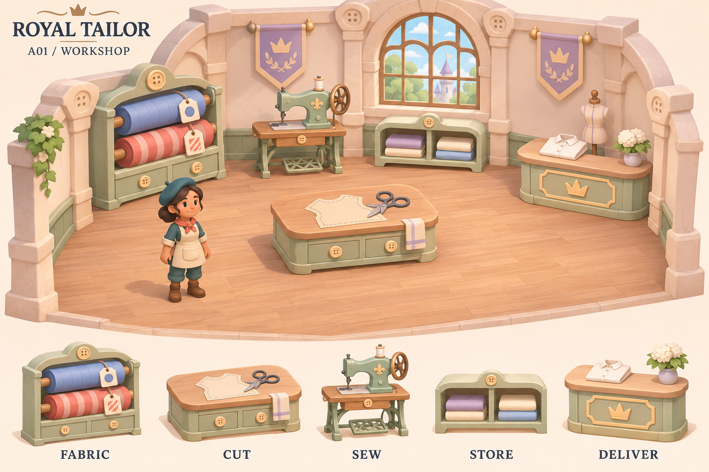
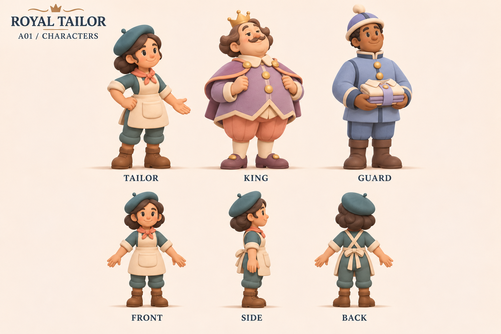

# A01 · 왕실 수선소 공간과 캐릭터 콘셉트

**2026-11-06 / 아트 디렉션 첫 제안 / 검토용**

확정된 ‘A. 따뜻한 동화책 스타일 — 파스텔·둥근 로우폴리 3D’를 구체화한 첫 공간·캐릭터 시안입니다. 이번 외형과 배치, 등장인물의 세부 설정은 제안입니다.

## 디자인의 중심

**작은 재단사의 손길이 왕궁의 하루를 바꾸는, 따뜻한 수선 공방.**

왕궁의 격식은 아치·왕관·작은 깃발로 표현하고, 수선소의 정체성은 단추·실밥·원단·재봉틀로 보여 줍니다. 둥근 큰 형태와 무광 소재를 사용하며, 이동 경로에는 장식을 최소화합니다.

이 게임만의 반복 요소는 ‘단추 모양 연결부’, ‘짧은 스티치 테두리’, ‘원단처럼 부드러운 곡면’으로 제안합니다. 배경은 밝게, 조작 캐릭터의 모자는 짙게 두어 화면에서 찾기 쉽도록 합니다.

## 1. 첫 공간 — 왕궁 안의 작은 재봉 공방

크림색 석벽, 꿀빛 목재, 세이지색 가구와 아치 창을 중심으로 구성했습니다. 중앙 재단대 주변에 빈 바닥을 확보하고, 재료·기계·보관·납품 시설을 가장자리로 배치하는 방향입니다.

| 시설 | 형태로 알아보는 특징 | 제작 시 유지할 기준 |
|---|---|---|
| 원단창고 | 큰 원단 롤과 재료 태그 | 빨강/파랑뿐 아니라 줄무늬/원형 표시 병행 |
| 재단대 | 낮고 넓은 상판·가위·의상 패턴 | 재단물이 상판에서 잘 보이고 캐릭터를 가리지 않음 |
| 재봉틀 | 큰 측면 바퀴·기계 아치 | 자동 작업 상태는 바퀴 움직임과 진행 표시로 전달 |
| 임시 보관대 | 열린 2칸 구조 | 빈 칸과 점유한 칸을 구분 |
| 납품대 | 왕관 문양과 접수 상판 | 일반 보관대와 다른 실루엣·완료 피드백 |

작업대 외장은 공용 목재·세이지 재질로 통일하고, 기능은 상판 형태와 도구·문양으로 구분합니다. 선택·작업·완료 상태를 나타내는 표시와 효과는 게임 화면에서 별도로 설계합니다.

공간 그림은 분위기와 오브젝트 형태를 검토하는 시안입니다. 곡선 외벽과 가구 위치는 확정 도면이 아니며, 기존 12×8m 블록아웃 제안에 그대로 대응하는 치수 도면으로 사용하지 않습니다.

## 2. 핵심 캐릭터 3종

| 캐릭터 | 역할 | 핵심 외형 | 행동과 표정 방향 |
|---|---|---|---|
| 재단사 / 플레이어 | 주문을 직접 제작하는 주인공 | 청록 베레모·코랄 스카프·크림 앞치마·큰 주머니·둥근 부츠 | 집중할 때 몸을 약간 앞으로, 성공하면 자신 있는 작은 포즈 |
| 임금님 | 왕실 주문과 변덕을 보여 주는 고객 | 배 모양 몸통·라벤더 코트·작은 왕관·짧은 망토 | 눈썹·콧수염·손짓으로 만족과 망설임을 표현 |
| 근위병 | 배송·검문·근위병 에피소드의 인물 | 길쭉한 몸통·블루 제복·둥근 모자·큰 단추 | 반듯한 자세에 살짝 허둥대는 동작으로 친근한 분위기 |

재단사의 정면·측면·후면을 함께 제시했습니다. 청록 모자와 큰 앞치마 주머니를 시점이 바뀌어도 유지하는 기준으로 삼습니다. 이름, 성별 설정, 배경 이야기는 이번 이미지로 확정하지 않습니다.

첫 구현용 캐릭터는 기존 계획대로 재단사 1체를 우선합니다. 임금님·근위병은 세계관을 함께 검토하기 위한 외형 제안이며 즉시 모델링해야 할 제작 범위를 추가하지 않습니다.

## 3. 독립 튜토리얼과 에피소드 공간 확장 제안

아래 공간은 동일한 작업대 기능과 공용 가구를 재사용하며, 건축 모듈·재질·장식·조명으로 차이를 만드는 방향입니다. 이번에 이미지로 제작한 공간은 첫 공방 1종입니다.

| 구분 | 공간 제안 | 색과 재질 | 공간에서 느끼게 할 변화 |
|---|---|---|---|
| 독립 튜토리얼 | 공방 옆 작은 연습방 | 크림·민트, 밝은 목재 | 기능을 순서대로 배우는 단순한 배치. 정규 60맵·별 평가 제외 |
| EP01 왕실의 부름 | 왕궁 안의 기본 수선 공방 | 크림·세이지·꿀빛 목재 | 익숙하고 따뜻한 첫 왕실 작업 공간 |
| EP02 변덕쟁이 임금님 | 왕실 의상실과 피팅 공간 | 피치·라벤더·무광 금색 | 의상 견본과 변경 알림판으로 왕의 취향 변화 표현 |
| EP03 근위병 대소동 | 근위대 제복 수선실과 안뜰 | 스카이블루·청회색·밝은 석재 | 반복되는 문틀·제복 걸이·순찰 표식으로 질서와 소동 표현 |
| EP04 왕궁 무도회 | 무도회장 뒤편 의상 준비실 | 더스티 로즈·라벤더·샴페인 | 커튼·가면·드레스 실루엣으로 행사 직전의 분주함 표현 |
| EP05 이웃국가의 귀빈 | 귀빈용 접견 별관과 의복 접수실 | 민트·아이보리·코랄, 금실 포인트 | 가상 왕국 문양·접수·포장으로 세심한 환대 표현 |

EP05의 문양은 실제 국가·민족을 단순화한 표현 대신 가상 왕국의 기하학·식물 문양으로 개발합니다. ‘보이지 않는 옷’ 엔딩은 넣지 않습니다.

## 4. 공통 팔레트

| 색 | 값 | 주 사용처 |
|---|---|---|
| 크림 | #FFF0D3 | 벽·앞치마·배경 |
| 피치 | #F3D4C6 | 천·부드러운 장식 |
| 민트 | #D7E9DE | 공방 가구·보조 면 |
| 라벤더 | #E3DAEE | 왕실·임금님·에피소드 강조 |
| 스카이블루 | #D9E7F5 | 제복·차가운 재료 |
| 짙은 청록 / 추가 제안 | #397D7C | 플레이어 모자와 의상 구분 |
| 잉크 | #26354E | UI 글자·작은 강조 |

조명과 재질에 따라 이미지의 실제 픽셀 색은 달라집니다. 표의 값은 제작 시 재질·UI 색을 논의하는 기준입니다.

## 5. 3D 제작으로 넘기기 전 확인할 내용

- 기존 제안인 캐릭터 1.4m, 머리 높이 약 35%, 작업대 0.8m를 실제 모델로 비교합니다. 이미지의 비율을 실측값으로 취급하지 않습니다.
- 콘셉트에는 부드러운 렌더링과 천 주름이 포함되어 있습니다. 실제 로우폴리 모델에서는 큰 덩어리를 유지하고 작은 주름·장식을 줄입니다.
- 재단사 1체와 작업대 5종을 실제 게임 카메라에 놓고 손·소지품·작업물을 구분할 수 있는지 확인합니다.
- 실제 휴대폰 크기에서 청록 모자가 배경과 구별되는지, 모자·가구가 손의 행동을 가리지 않는지 확인합니다.
- 벽 가림 처리, 이동 폭, 납품대 접근, 상태 표시와 UI 영역은 블록아웃에서 검증합니다.
- 이번 정면·측면·후면은 형태 참고 이미지입니다. 정밀 모델링용 정투상 도면, 공용 리그, 애니메이션, 메시와 텍스처 예산은 별도 작업입니다.

**권장 다음 작업:** 재단사와 재단대·재봉틀을 단순한 3D 덩어리로 만들어 게임 시점과 크기를 먼저 검증한 뒤, 최종 캐릭터 비율과 디테일을 정합니다.

## 파일과 원본 기준

- [공간 보드 PNG](workshop-a01.png)
- [캐릭터 보드 PNG](characters-a01.png)
- [이미지 생성 방식과 전체 프롬프트](prompts.md)
- [기존 Figma 아트 제작 기준](https://www.figma.com/design/GUBBsgjCI1Fb8SEq9aonvi?node-id=37-82)
- [기존 EP01-01 블록아웃](https://www.figma.com/design/GUBBsgjCI1Fb8SEq9aonvi?node-id=35-312)

두 보드는 내장 이미지 생성 도구로 만든 PNG 콘셉트입니다. 공간 보드를 시각 기준으로 삼아 캐릭터 보드를 제작했습니다. 이번 산출물은 GitHub에 보관하며 기존 Figma 문서·프레임은 변경하지 않았습니다.
