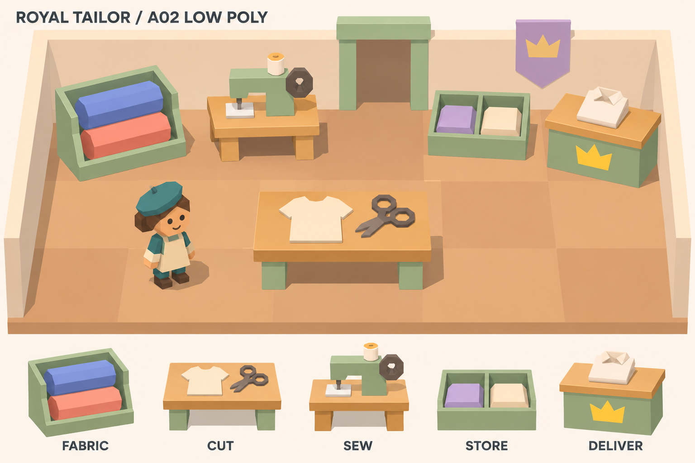
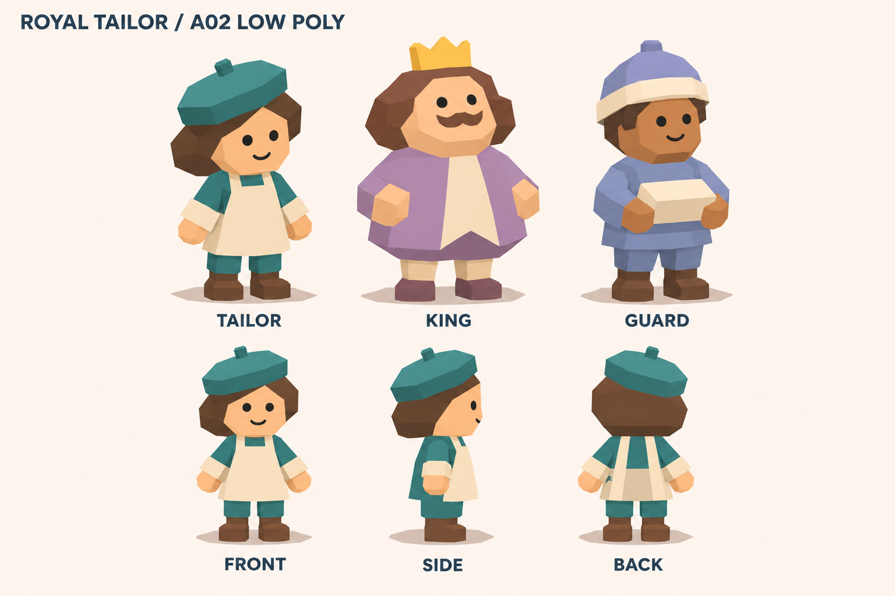

# A02 · 심플 로우폴리 공간과 캐릭터

**2026-11-06 / 사용자 수정 요청 반영 / 최신 검토용 시안**

사용자 피드백: **“더 심플하게. Low poly로!! 오버쿡 정도면 충분!”**

앞으로의 아트 기준은 오버쿡 정도의 단순한 게임 오브젝트와 읽기 쉬운 실루엣입니다. A01의 정교한 표면·작은 장식·풍부한 조명 표현을 줄이고, 파스텔 색과 왕실 수선소의 역할 구분을 유지했습니다. A02의 구체적인 외형은 검토용 제안입니다.

## 공간

- 직사각형 바닥, 단순한 벽과 출입구, 왕관 깃발 1개로 공간을 구성합니다.
- 나뭇결·석재 질감·식물·꽃병·마네킹·건축 장식을 제거했습니다.
- 원단창고·재단대·재봉틀·2칸 보관대·납품대를 상자와 다각형 원통 중심으로 단순화했습니다.
- 재봉틀은 몸체·바퀴·실패만으로 알아볼 수 있게 합니다.
- 넓은 바닥과 낮은 작업대로 이동·소지품·작업물을 확인하기 쉽게 만드는 방향입니다.

## 캐릭터

- 짧은 몸과 큰 머리, 넓은 다각형 면으로 구성합니다.
- 얼굴은 점눈과 간단한 입, 머리카락은 큰 덩어리로 처리합니다.
- 손가락 대신 벙어리장갑 형태, 신발은 단순한 덩어리를 사용합니다.
- 천 주름·봉제선·머리카락 가닥·작은 장신구를 생략합니다.
- 재단사: 청록 모자와 크림 앞치마.
- 임금님: 넓은 몸통과 라벤더 의상, 작은 왕관.
- 근위병: 블루 의상과 단순한 모자, 접힌 옷.
- 재단사의 정면·측면·후면을 함께 제공합니다.

## 제작 기준

**큰 형태 → 적은 색 → 명확한 기능 구분** 순서로 만듭니다. 기본 도형과 단색 재질을 중심으로 하고, 세밀한 텍스처와 장식은 추가하지 않습니다. 캐릭터와 작업대는 작은 게임 화면에서 역할이 보여야 합니다.

‘오버쿡 정도’는 시각적 단순함과 제작 범위의 기준입니다. 특정 게임의 캐릭터·에셋을 복제하거나 실제 폴리곤 수를 추정한 것이 아닙니다. 이 PNG로 삼각형 수나 성능을 측정할 수 없으므로 실제 모델 예산은 게임 카메라·목표 기기에서 별도로 확인합니다.

다음 제작에서는 재단사 1체와 재단대·재봉틀부터 단순한 실제 3D 모델로 만들고, 게임 시점에서 크기와 동작을 확인합니다.

## 원본

- [공간 PNG](workshop-a02.png)
- [캐릭터 PNG](characters-a02.png)
- [생성 방식과 전체 프롬프트](prompts.md)
- [이전 A01 기록](../a01/README.md)

내장 이미지 생성 도구로 A01을 단순화한 PNG 시안입니다. 모델링 원본이나 메시 파일은 아닙니다.
